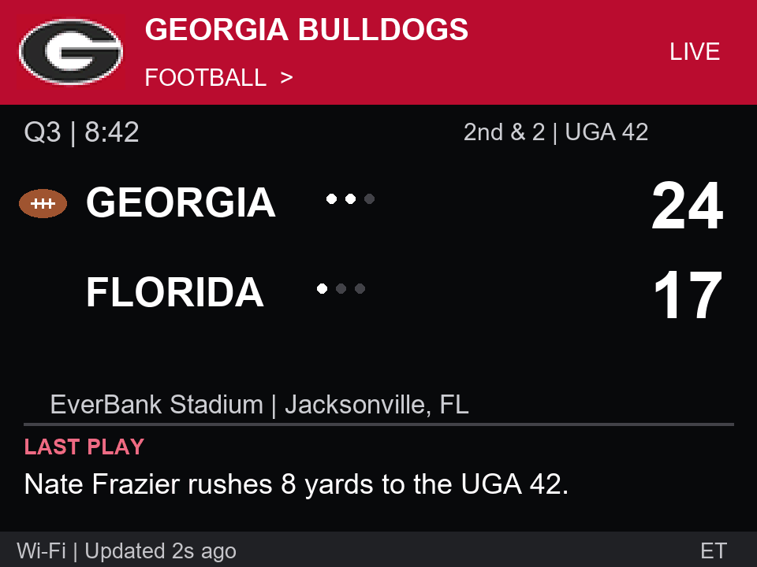

# Georgia Bulldogs desk scoreboard

Firmware for the ESP32-2432S028 family with ILI9341 or ST7789 display and XPT2046 resistive touch. Football, men's basketball, and baseball only. Hardware validation is in progress; screen variants require the correct panel setting.

*Illustrative preview, not a live game.*

**[View the overview: display preview and how the scoreboard works](docs/overview.md)**

## Controls

- Tap the sport title in the red header to cycle Football → Men's basketball → Baseball.
- Tap the Georgia G to see that sport's next three published games. The screen returns after seven seconds; tap G again to return immediately.
- Hold the physical BOOT button for 2.5 seconds to calibrate touch, then firmly press the two crosses as prompted.
- At startup, live games automatically take priority in the order football, basketball, baseball. Manually switching sports keeps that sport selected until restart.

## Display

The sport's ball icon marks possession or the batting team when reported. Timeouts use bright remaining dots and dim used dots. Basketball bonus appears under the team name when reported. Baseball balls, strikes, and outs appear under the batting team. Venue precedes city below the scores. Long venue and last-play text scroll.

Timeout plays display `TIMEOUT - GEORGIA` or the opponent's name when available; official/media timeouts are labeled separately. Unknown timeout team is shown as `TIMEOUT`.

Schedules use Eastern time with daylight saving changes. Unannounced start times show TBD. Scores are polled about every 30 seconds for the selected sport; background sports are checked about every 90 seconds. The last successful update is shown, and old possession/timeout indicators are hidden when stale.

The ESPN public website JSON feeds are unofficial, may change, and do not supply every field for every game. Missing timeout, bonus, possession, count, or play-by-play information is left unavailable rather than guessed. Baseball coverage varies. This is a score display, not a synchronized broadcast clock.

## Wi-Fi

Credentials are stored in the board's local preferences, not in these source files. If connection fails, join `Dawgs-Setup` (password `GoDawgs!`) and open `http://192.168.4.1` to choose a 2.4 GHz Wi-Fi network. The portal times out after three minutes; restart to retry.

Serial provisioning is also supported at 115200 baud: send `WIFI ` followed by a JSON object with `ssid` and `password`, then a newline. The device acknowledges `WIFI_SAVED` without echoing the credentials. `STATUS` reports connection information.

For a password prompt that does not save credentials to a file, install `pyserial` and run `python tools/configure_wifi.py --port COM8`.

## Display variants

The default panel setting is ST7789; the alternative is ILI9341. At 115200 baud, send `PANEL ST7789` or `PANEL ILI9341` with a newline to switch and save the setting without reflashing. Both use 320 × 240 landscape. ST7789 color options are `INVERT 0` / `INVERT 1` and `BGR 0` / `BGR 1`; the defaults are inversion off and RGB ordering. The display uses HSPI and touch uses VSPI so they cannot overwrite one another's pin configuration. SPI runs at 20 MHz for compatibility.

## Build

Install PlatformIO, open this folder, and run `pio run`. Use `pio run -t upload --upload-port COM8` to flash. If automatic reset fails, hold BOOT, tap RESET, keep BOOT held as the upload connects, then release it once writing starts. If a fast upload disconnects, use 115200 baud.

Board pins: display SCK 14 / MOSI 13 / MISO 12 / CS 15 / DC 2 / backlight 21. Touch SCK 25 / MOSI 32 / MISO 39 / CS 33 / IRQ 36.

The Georgia G asset is sourced from the FBS Logo Library. Georgia marks belong to their respective owner. The feed's verified TLS root certificate is included in `include/feed_ca.h`.
