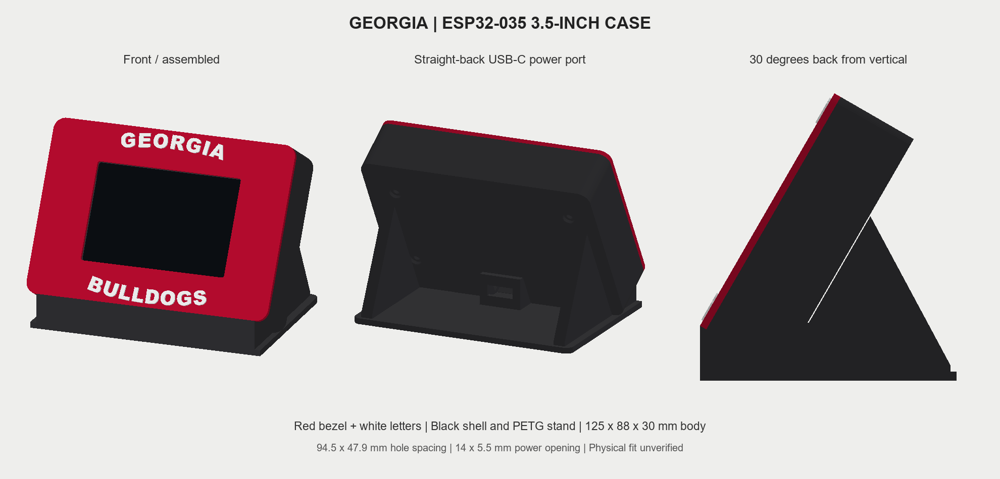

# Georgia ESP32-035 case - migration revision 1



## Parts and colors

| File | Color | Quantity |
| --- | --- | --- |
| front-bezel-red.stl | Red | 1 |
| lettering-white.stl | White | 1 set of 15 letters |
| rear-shell-black.stl | Black | 1 |
| stand-black.stl | Black | 1 |

Red front, white raised lettering, black rear and fixed stand. The body is 125 x 88 x 30 mm. The lower gap is filled, with no stylus holder. The USB-C power adapter faces straight backward, parallel to the desk, and its lower mount rests at the base.

## ESP32-035 hardware assumptions

- Board outline: 101.5 x 55.5 mm. Four mounting holes (assumed 3.2 mm; the supplied drawing does not label their diameter) at 94.5 x 47.9 mm center spacing, per the supplied board diagram.
- Body: 125 x 88 x 30 mm. Stand: 119 mm wide, approximately 84 mm deep after front trimming. Fixed 30-degree tilt back from vertical.
- Visible window: 74.2 x 49.6 mm around an assumed 73.44 x 48.96 mm active area; this active-area size is not dimensioned on the supplied image. Provisional centered glass pocket: 85.6 x 56.1 mm, based on the 85 mm glass width and full-board height shown. Measure the actual glass outline and offset before printing.
- PCB thickness 1.6 mm and front PCB plane 6.8 mm behind the bezel face are provisional. The pocket floor is 1.8 mm behind the front; this allows a nominal 5 mm screen stack. Do not clamp the screen if the actual stack differs.
- Four M3 heat-set inserts: assumed 4.6 mm outside diameter x 4 mm long, in 4.6 mm pilot pockets 4.3 mm deep. Use the insert supplier's recommended pilot size, adjusting `insert_od` as needed.
- Four M3 x 25 mm button-head screws are suggested for this deeper case, assuming 6.2 mm diameter x 1.8 mm head recesses. Check screw length against the actual assembled stack so screws engage the inserts without bottoming out.
- USB-C adapter opening: exactly 14 mm wide x 5.5 mm tall, with no added clearance. The vertical mounting face is 2.4 mm thick and the pad rests at base level. A stand recess clears the lowered pad. Adapter retention clips, flange size, solder pads, cable bend space, and internal wiring fit remain unverified.
- The board diagram shows edge USB, SD, switches and connectors. The larger cavity leaves space around the PCB but does not provide outside access cutouts to every board connector. Open the shell for programming, SD or button access. No battery or speaker is included in this design.

No physical fit, load, or print test has been performed on the new case. Do not reuse the old 2.8-inch case dimensions. Digital mesh and interference checks do not establish hardware fit.

## PETG printing recommendations

Use red PETG for the bezel, white PETG for the lettering, and black PETG for the shell and stand. These are starting settings, not a tested printer profile. Use your filament maker's temperature profile and dry filament as directed.

For a 0.4 mm nozzle, start with 0.20 mm layers, 4 walls, 5 top/bottom layers, and 20-30% gyroid infill. Print the small white letters at 0.12-0.16 mm layers if desired. Use a 3-5 mm brim where adhesion is limited, especially for the lettering. Use a PETG-compatible build surface; follow its maker's release-layer instructions.

| Part | Orientation | Supports |
| --- | --- | --- |
| Red bezel | Front face down, bosses up | Off initially. Inspect the shallow lettering-pocket bridges and screen pocket in the slicer. Keep support out of insert pockets. |
| White letters | Flat, supplied orientation | Off. Print slowly and keep the matching layout for assembly. |
| Black rear shell | Supplied orientation, projecting USB pad lowest | Normal/snug supports under the elevated rear face; allow supports from model surfaces where needed inside the port pad. Use manual painting to cover unsupported pad ceilings. Avoid filling screw bores with support. |
| Black stand | Flat base down | Off initially. Inspect brace slopes and the top of the solid lower support for unsupported toolpaths. |

For PETG supporting PETG, start with a **0.30 mm top Z gap**, **0.30 mm bottom Z gap**, **0.6 mm XY separation**, **3 interface layers**, **80% interface density**, and **12-15% support density**. Use a 45-degree overhang threshold measured from the horizontal; slicers use different angle conventions. These values trade underside finish for easier removal. Slicers may round Z gaps to layer increments, so inspect the effective gap. Do not use a zero Z gap for same-material supports. Add local supports only where the preview shows they are needed, and ensure they remain removable through the open shell.

The rear shell is the most support-dependent part. Preview every layer around the vertical USB-C mounting pad; the opening must stay 14 x 5.5 mm after cleanup. A side orientation may reduce the broad supported rear surface but increases shell height and may need a brim. No orientation has been physically tested.

Import all STLs in millimeters at 100%. Each file's lowest point is at the bed. Letter pockets have approximately 0.12 mm side clearance and seat 0.6 mm deep, leaving the letters 0.6 mm raised. Use suitable adhesive if needed.

Sources: [Prusa PETG material guide](https://help.prusa3d.com/article/petg_2059) and [Sovol support settings guide](https://www.sovol3d.com/blogs/news/3d-printing-support-settings-explained-how-to-get-cleaner-easier-to-remove-fdm-prints). Part orientations and support placements above are design-specific recommendations based on this CAD geometry.

## Assembly

1. Install the white GEORGIA and BULLDOGS letters into their matching recesses on the front bezel.
2. Install the four M3 inserts from the **inside/rear** of the front bezel. Keep them coaxial and flush with the boss tops; protect the thin front skin from excess heat or insertion force.
3. Install the USB-C power adapter in the rear opening, and provide internal strain relief appropriate to its actual body. The model supplies the opening, not custom latches for an unspecified adapter.
4. With USB disconnected, connect the adapter's regulated 5 V and ground to the board's 5 V/VIN and GND. This port is power only. Identify the actual board connections before wiring.
5. Seat the board screen-first into the bezel pocket. The four front bosses support the PCB around its mounting holes; the display must not bear screw-clamping force.
6. Place the black rear shell over the board. Its hollow support columns contact the rear of the PCB at the same four mounting holes.
7. Insert each rear screw along the shared axis: **rear screw → rear support column → PCB hole → front heat-set insert**. Tighten only until seated. The screws must neither bend the PCB nor press the screen against the bezel.
8. Seat the assembled case against the black cradle's rear side braces, which set the 30-degree angle. The solid lower plinth supports the case underside. Secure the shell to the two rear braces with suitable adhesive or thin mounting tape so it cannot slide forward when tapped. Keep the rear screws and USB opening clear.
9. Remove the rear shell when access to BOOT, RESET, or the original USB programming socket is needed.

## Editable source

`parameters.json` contains the dimensions. `design_case.py` regenerates the STLs and the colored `case-assembly.glb` preview. Install Python dependencies with:

```text
pip install manifold3d trimesh numpy fonttools
python design_case.py
```

The lettering uses Arial Black when available. On other systems, set `GEORGIA_CASE_FONT` to a bold TrueType font path before regenerating. A different font changes the letter pockets, so always regenerate the bezel and lettering together.

`case-assembly.glb` is for viewing the assembled design; it includes non-printable screen reference. Print the individual STLs. `validation.json` records digital mesh checks, not a physical-fit certificate.

## References

- Supplied JC4827W543 board structure diagram: [mounting dimensions](../docs/board-dimensions.png).
- ESP32-035 reference: original ESP32, shared display/XPT2046 SPI GPIO14/13/12, backlight GPIO27.
- [ESP32-035 hardware mapping](https://github.com/littleCdev/ESP32-035/blob/master/Hardware.md).
