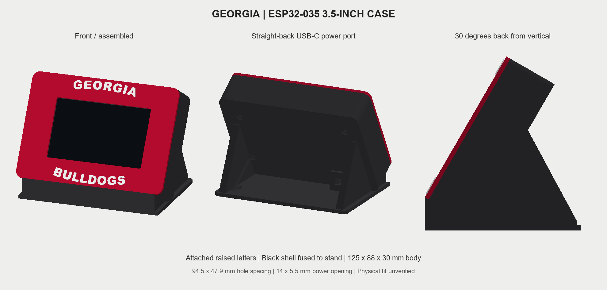

# Georgia ESP32-035 case - attached parts revision, November 9, 2026

## Two printed parts

| File | Print color | Description |
| --- | --- | --- |
| front-bezel-with-lettering.stl | Red, then white for raised letters | Bezel and GEORGIA/BULLDOGS letters are one connected solid |
| rear-shell-and-stand.stl | Black | Rear shell, support ribs and flat stand are permanently fused into one connected solid |

There are no loose letters or separate stand. The front still unscrews for board access. The rear/stand joint is reinforced by two 6 mm wide ribs bridging the former cradle gap. Four 7 mm screwdriver channels preserve access to the rear screw heads. The USB-C opening remains horizontal, facing straight backward parallel to the desk, at base level. The lower front gap remains filled, with a solid front face and no USB tunnel opening. The USB adapter and its internal clearance channel are offset 35 mm toward the left when viewed from the display side, closer to the onboard USB connector.

## ESP32-035 hardware assumptions

- Board outline: 101.5 x 55.5 mm. Four mounting holes (assumed 3.2 mm; the supplied drawing does not label their diameter) at 94.5 x 47.9 mm center spacing, per the supplied board diagram.
- Body: 125 x 88 x 30 mm. Stand: 119 mm wide, approximately 84 mm deep after front trimming. Fixed 30-degree tilt back from vertical.
- Visible window: 74.2 x 49.6 mm around an assumed 73.44 x 48.96 mm active area; this active-area size is not dimensioned on the supplied image. Provisional centered glass pocket: 85.6 x 56.1 mm, based on the 85 mm glass width and full-board height shown. Measure the actual glass outline and offset before printing.
- PCB thickness 1.6 mm and front PCB plane 6.8 mm behind the bezel face are provisional. The pocket floor is 1.8 mm behind the front; this allows a nominal 5 mm screen stack. Do not clamp the screen if the actual stack differs.
- Four M3 heat-set inserts: assumed 4.6 mm outside diameter x 4 mm long, in 4.6 mm pilot pockets 4.3 mm deep. Use the insert supplier's recommended pilot size, adjusting `insert_od` as needed.
- Four M3 x 25 mm button-head screws are suggested for this deeper case, assuming 6.2 mm diameter x 1.8 mm head recesses. Check screw length against the actual assembled stack so screws engage the inserts without bottoming out.
- USB-C adapter opening: exactly 14 mm wide x 5.5 mm tall, with no added clearance. The vertical mounting face is 2.4 mm thick and the pad rests at base level. A stand recess clears the lowered pad. Adapter retention clips, flange size, solder pads, cable bend space, and internal wiring fit remain unverified.
- The board diagram shows edge USB, SD, switches and connectors. The larger cavity leaves space around the PCB but does not provide outside access cutouts to every board connector. Open the shell for programming, SD or button access. No battery or speaker is included in this design.

No physical fit, load, or print test has been performed on the new case. Do not reuse the old 2.8-inch case dimensions. Digital mesh and interference checks do not establish hardware fit.

## PETG printing and attached white letters

Use PETG for both parts. Start with a 0.4 mm nozzle, 0.20 mm layers, 4 walls, 5 top/bottom layers and 20-30% gyroid infill. Use the filament maker's temperature profile and a PETG-compatible bed surface. These are starting settings, not a printer-tested profile.

**Front:** the supplied STL is oriented with the insert-boss ends at the bed and the raised lettering facing upward. Its total height is 7.4 mm. The main front face ends at Z=6.8 mm; only the letters extend from 6.8 to 7.4 mm. Print red first, then use a slicer filament-change pause at the first letter-only layer above 6.8 mm to change to white PETG. Check the layer preview; layer numbering depends on first-layer height. White letters bond directly to the red bezel during printing. Painting the raised letters is also possible. STL files contain geometry only; the white preview is a suggested color assignment.

The front needs removable supports under the broad inside/back surface because it starts on its bosses. Paint supports on the rear of the bezel and keep them out of insert pockets and the display opening. Remove support residue before seating the PCB. A 3-5 mm brim around the boss footprints can help adhesion. Do not use the former face-down orientation: attached letters are now raised beyond the face.

**Rear and stand:** print the flat base on the bed in the supplied assembled orientation. The fixed 30-degree screen tilt is built into the solid. Check the top rim/roof of the open shell, USB adapter recess, and screw-access channels for unsupported spans. Use normal/snug or painted supports where needed, including from model surfaces if needed inside the shell. Keep supports removable through the large front opening; avoid packing the screw bores and USB-C opening. Printing the rear face flat is no longer possible because the stand is integral.

For PETG supporting PETG, initial values are a 0.30 mm top/bottom Z gap, 0.6 mm XY separation, 3 interface layers, about 80% interface density and 12-15% support density. Inspect the effective gaps in the slicer, since some round them to full layers. Do not use a zero gap with same-material supports. Final orientations, support removal and print strength remain untested.

## Assembly

1. Print the front with attached raised letters and the combined black rear/stand. Remove supports and inspect all holes, the display pocket and USB-C opening.
2. Install four M3 heat-set inserts from the inside/rear of the front bezel, flush with boss tops. Match insert dimensions to the assumptions below and protect the thin front face from overheating.
3. Install the USB-C power-only adapter in the combined rear/stand. Confirm flange/clip fit and provide suitable internal strain relief.
4. With USB disconnected, connect the adapter's regulated 5 V and ground to the board's identified 5 V/VIN and GND. The case opening does not supply voltage regulation or USB-C power negotiation.
5. Seat the board screen-first in the front pocket, with the PCB holes on the insert bosses. Verify that the display is not carrying screw-clamping force.
6. Fit the front/PCB into the combined rear/stand and insert the four rear screws along the original shared axes: screw, rear column, PCB hole, front insert. The extended channels allow screwdriver access through the stand braces. Tighten only until seated; screws must not bottom out or bend the PCB.
7. The rear shell is already attached permanently to the stand. No stand adhesive or attachment operation is required. Unscrew and lift off the front for board connector, BOOT, RESET or SD access.

## Validation and source

Both STL files are closed, positive-volume meshes with exactly one connected solid each. Front and combined rear/stand have no meaningful CAD intersection. Lettering overlaps the front face by 0.6 mm before the Boolean union; it is not a separate set of glyphs. The joint ribs overlap both the shell and stand. No physical print-fit or strength test has been performed.

Edit parameters.json, then run design_case.py. Run render_preview.py for the CAD preview. Install requirements.txt first. Arial Black is used when available; GEORGIA_CASE_FONT can select another bold TrueType font. The GLB is a colored viewing model and includes a non-printable screen reference. Print only the two named STLs.

## References

- [Supplied ESP32-035 dimensions](../docs/board-dimensions.png).
- [ESP32-035 hardware mapping](https://github.com/littleCdev/ESP32-035/blob/master/Hardware.md).

## Lettering orientation correction

The raised lettering is reversed in the local front model so it reads correctly from the exterior of the finished bezel. The assembled preview uses a rigid rotation matching the printable part. Use the refreshed front STL and ZIP, replacing the earlier attached-lettering export.
